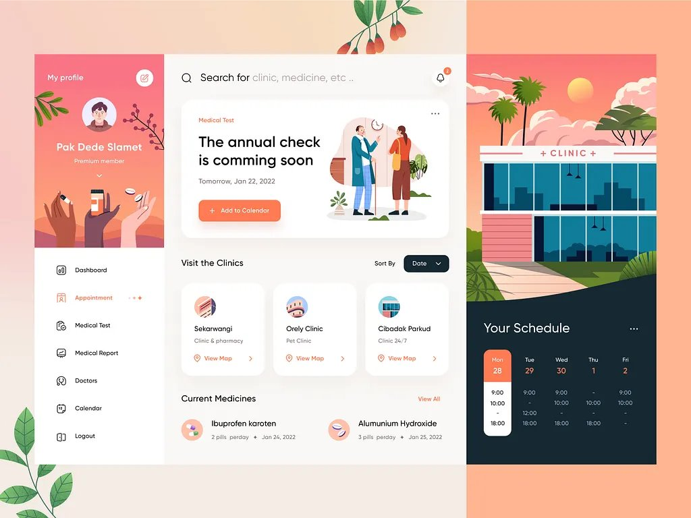
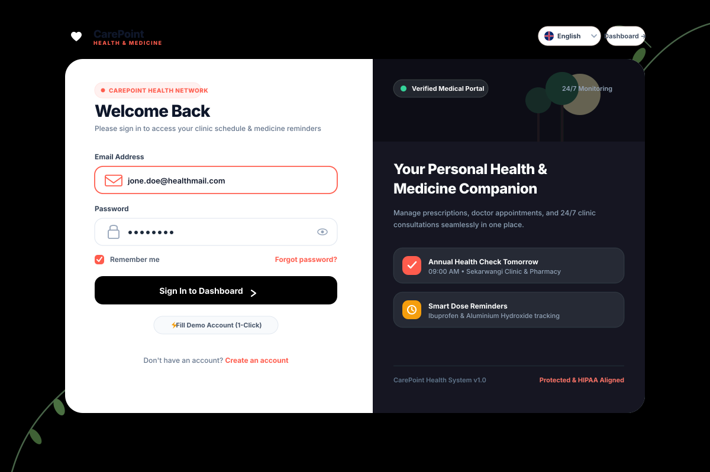
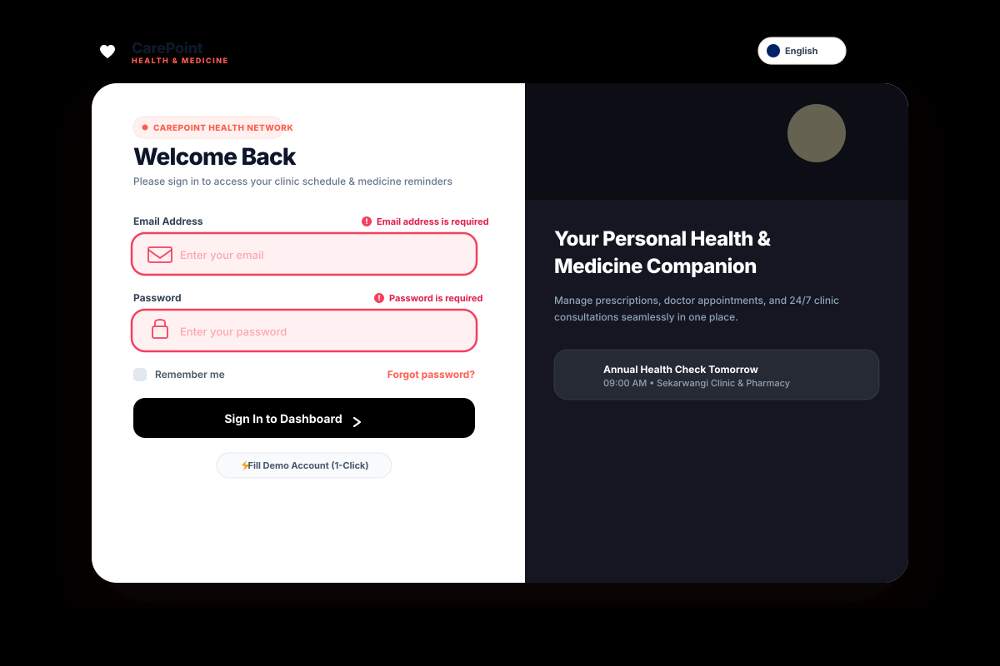

<div align="center">

# 🩺 CarePoint — Medicine Reminder & Clinic Schedule System

**A modern, pixel-faithful health management dashboard & authentication platform built with React 18, Vite 6, and Tailwind CSS.**

[](https://react.dev/)
[](https://vitejs.dev/)
[](https://tailwindcss.com/)
[](#-multi-language-support-en--ku--ar)
[](LICENSE)

</div>

---

## 🎯 System Objective & Purpose

> **CarePoint** is purposefully designed to **assist elderly individuals, chronic care patients, and individuals managing ongoing treatments** to stay organized, confident, and on track with their personal healthcare routine.

### Key Goals:
- 💊 **Medication Adherence & Organization**: Empower elderly people and patients to stay on track with their prescribed medicines, daily dosages, and refill alerts, eliminating the risk of missed or duplicate pills.
- 🩺 **Doctor & Clinic Follow-Up**: Streamline follow-ups for upcoming doctor consultations, routine physical examinations, lab tests, and 24/7 clinic appointments.
- 👵 **Accessible, Patient-Centered Design**: Features a warm, dignified aesthetic with large legible typography, intuitive visual indicators, positive reinforcement (confetti celebrations upon taking doses), and native multi-language support (**English**, **Kurdish**, and **Arabic**) to ensure accessibility for elderly patients and diverse families.

---

## 📸 Screenshots Showcase

### 1. Main Dashboard View
> *Pixel-faithful 3-column medical layout featuring user profile, clinic directory, medication manager, and interactive 5-day timetable schedule.*

<div align="center">
  
</div>

<br />

### 2. Modern Login Page & Authentication
> *Aesthetic split-screen authentication portal with CarePoint branding, feature showcase, and persistent multi-language switcher.*

<div align="center">
  
</div>

<br />

### 3. Real-Time Form Validation (Red Border & Error States)
> *Interactive form validation enforcing required fields and formatting with bold red borders and context-aware error messages.*

<div align="center">
  
</div>

---

## 🌟 Key Features

### 🔐 1. Authentication & Form Validation
- **Visual Error Indicators**: When fields are left empty or formatted incorrectly, inputs dynamically display **bold red borders** (`border-2 border-rose-500 ring-2 ring-rose-100`) and clear error alerts with icons.
- **Dynamic Field Recovery**: Error borders and messages automatically clear in real-time as soon as the user enters valid text.
- **1-Click Demo Account Fill**: Pre-populates verified credentials (`jone.doe@healthmail.com`) and clears all errors instantly for frictionless testing.
- **Password Visibility Toggle**: Interactive show/hide toggle for password security.
- **Simulated Authentication Flow**: Loading state spinner and smooth transition into the dashboard with a personalized welcome toast.

### 📊 2. Clinical Dashboard
- **Sidebar & User Profile Card**:
  - Displays user profile (**Jone Doe**, *Premium member*).
  - High-resolution master artwork background featuring diverse hands holding medicine capsules, prescription bottles, and tablets over sunset dunes.
  - Interactive navigation menu (`Dashboard`, `Appointment`, `Medical Test`, `Medical Report`, `Doctors`, `Calendar`, `Logout`).
- **Hero Banner ("The annual check is comming soon")**:
  - Features the doctor & patient consultation scene artwork.
  - `+ Add to Calendar` CTA button opening the interactive schedule planner modal.
  - Three-dot options menu for preparation guidelines and rescheduling.
- **Visit the Clinics Directory**:
  - Interactive cards for **Sekarwangi** (Clinic & pharmacy), **Orely Clinic** (Pet Clinic), and **Cibadak Parkud** (24/7 Emergency Clinic).
  - Multi-criteria sorting dropdown (`Date`, `Name`, `Rating`).
  - *"View Map >"* action modal with operating hours, phone contact, available services, and instant appointment booking.
- **Current Medicines Tracker**:
  - Prescription item cards with dosage, frequency, and date.
  - Interactive **"Take" button** with celebratory **confetti particle effects**.
  - Detailed prescription dosage modal with remaining stock progress bar and refill alert request.
- **Your Schedule Timetable**:
  - Architectural sunset `+ CLINIC +` hero illustration.
  - 5-column timetable matrix (`Mon 28`, `Tue 29`, `Wed 30`, `Thu 1`, `Fri 2`) with active coral badge.
  - Expandable agenda drawer with time blocks and categorized appointments.

### 🌐 3. Multi-Language Support (EN | KU | AR)
- **Three Supported Locales**:
  - 🇬🇧 **English (`en`)**: Left-to-Right (LTR) default.
  - ☀️ **Kurdish / کوردی (`ku`)**: Right-to-Left (RTL) Sorani Kurdish.
  - 🌍 **Arabic / العربية (`ar`)**: Right-to-Left (RTL) Modern Standard Arabic.
- **Dedicated Language Switcher**:
  - Prominently positioned in the header on both the Dashboard and the Login Page.
  - Circular regional flag badges sourced directly from the `languages` folder:
    - `uk-flag.png` for English
    - `ku-flag.png` for Kurdish
    - `iq-flag.png` for Arabic
  - Automatic `dir="rtl"` and `dir="ltr"` layout adaptation.
  - Typographic pairing of `Plus Jakarta Sans` with `Noto Sans Arabic`.
  - User language preference stored in `localStorage`.

---

## 🛠️ Tech Stack

| Technology | Purpose |
| :--- | :--- |
| **React 18** | Declarative, component-driven UI architecture |
| **Vite 6** | Ultra-fast build tool and local development server |
| **Tailwind CSS 3** | Utility-first styling with custom palette and RTL support |
| **Lucide React** | Consistent, crisp iconography across all views |
| **Canvas Confetti** | Delightful visual feedback when marking medicine doses as taken |
| **Google Fonts** | `Plus Jakarta Sans` & `Noto Sans Arabic` typography |

---

## 📁 Project Architecture

```text
medicine-reminder-system/
├── index.html                               # HTML5 entry with Noto Sans Arabic fonts
├── package.json                             # Dependencies & scripts
├── vite.config.js                           # Vite configuration
├── tailwind.config.js                       # Custom colors (coral, navy, cream) & fonts
├── postcss.config.js                        # PostCSS configuration
│
├── docs/
│   └── screenshots/
│       ├── dashboard.jpg                    # Full dashboard reference screenshot
│       ├── login.svg                        # Login page interface screenshot
│       └── login-validation.svg             # Login validation error state screenshot
│
├── public/
│   └── languages/
│       ├── uk-flag.png                      # UK flag icon for English
│       ├── ku-flag.png                      # Kurdish flag icon for Kurdish
│       └── iq-flag.png                      # Iraqi flag icon for Arabic
│
└── src/
    ├── main.jsx                             # React DOM root & LanguageProvider wrap
    ├── App.jsx                              # View controller (Dashboard ↔ Login)
    ├── index.css                            # Global Tailwind directives & custom scrollbars
    │
    ├── assets/
    │   ├── images/
    │   │   ├── clinic-hero.jpg              # Master + CLINIC + sunset building artwork
    │   │   ├── annual-checkup-illustration.jpg # Doctor & patient consultation scene
    │   │   └── profile-card-bg.jpg          # Profile card hands holding pills artwork
    │   ├── languages/                       # Bundled flag image assets
    │   └── illustrations/
    │       ├── BotanicalCorner.jsx          # Ambient corner leaf branches
    │       ├── ClinicHeroBuilding.jsx       # Sunset clinic header with wave curve
    │       └── PillIcons.jsx                # Medicine & clinic badge vector graphics
    │
    ├── components/
    │   ├── auth/
    │   │   └── LoginPage.jsx                # Split login page with red border validation
    │   ├── layout/
    │   │   ├── MainLayout.jsx               # Dashboard canvas & 3-column grid container
    │   │   ├── Sidebar.jsx                  # User profile card & navigation items
    │   │   ├── Header.jsx                   # Search bar, flag switcher & notification bell
    │   │   └── RightPanel.jsx               # Clinic hero illustration + schedule panel
    │   ├── dashboard/
    │   │   ├── AnnualCheckBanner.jsx        # Hero card with consultation illustration
    │   │   ├── ClinicList.jsx               # Clinics section & sort menu
    │   │   ├── ClinicCard.jsx               # Individual clinic card with rating & map link
    │   │   ├── MedicineList.jsx             # Current medicines section with toggle
    │   │   ├── MedicineItem.jsx             # Pill card with take/untake action
    │   │   └── SchedulePanel.jsx            # 5-column timetable matrix & day selector
    │   ├── modals/
    │   │   ├── AddScheduleModal.jsx         # Add to Calendar appointment / medicine modal
    │   │   ├── ClinicDetailModal.jsx        # Clinic directions, services & booking modal
    │   │   ├── MedicineDetailModal.jsx      # Prescription dosage & refill request modal
    │   │   ├── ProfileModal.jsx             # Member profile edit dialog
    │   │   └── NotificationDrawer.jsx       # Alerts & notifications popover
    │   └── ui/
    │       ├── LanguageSwitcher.jsx         # Dropdown switcher with flag icons
    │       └── Toast.jsx                    # Floating feedback confirmation toast
    │
    ├── context/
    │   └── LanguageContext.jsx              # i18n state, persistent language & RTL engine
    ├── data/
    │   ├── mockData.js                      # Curated clinics, medicines & schedule timetable
    │   └── navigation.js                    # Navigation links
    ├── hooks/
    │   └── useMedicineSchedule.js           # Central state hook for schedule, clinics & meds
    └── locales/
        ├── en.json                          # English translations
        ├── ku.json                          # Kurdish (Sorani) translations
        └── ar.json                          # Arabic (العربية) translations
```

---

## 🚀 Quick Start Guide

### 1. Prerequisites
Ensure you have **Node.js** (v18 or higher) installed on your machine.

### 2. Installation
Clone the repository and install all dependencies:
```bash
git clone https://github.com/your-username/medicine-reminder-system.git
cd medicine-reminder-system
npm install
```

### 3. Start Development Server
```bash
npm run dev
```
Open your browser and navigate to **[http://localhost:3000](http://localhost:3000)**.

### 4. Build for Production
To create an optimized production build:
```bash
npm run build
npm run preview
```

---

## 🧭 Page Navigation & Testing

You can seamlessly switch between views:
1. **Via the UI**:
   - Click **"Preview Login Page"** in the floating pill button at the bottom-left corner.
   - Click **"Logout"** at the bottom of the sidebar to access the Login Page.
   - On the Login Page, click **"Explore Dashboard"** or sign in to return to the Dashboard.
2. **Via URL Parameters**:
   - `http://localhost:3000/` &rarr; Loads the **Dashboard**.
   - `http://localhost:3000/?page=login` &rarr; Loads the **Login Page**.

---

## 🧪 Testing Form Validation

On the **Login Page**:
1. Leave the fields blank and click **"Sign In to Dashboard"**.
   - Both inputs will highlight with **prominent red borders** (`border-2 border-rose-500`) and display error messages (*"Email address is required"*, *"Password is required"*).
2. Enter an invalid email format (e.g. `invalid-email`) to observe the format validation error.
3. Click **"⚡ Fill Demo Account (1-Click)"** to auto-populate valid credentials (`jone.doe@healthmail.com` / `carepoint2022`) and observe all red borders and errors clear immediately.

---

## 🤝 Contributing Guidelines

We welcome contributions from developers, designers, translators, and healthcare advocates! Whether you are fixing a bug, adding a new feature, refining accessibility for elderly patients, or contributing a new language translation, your help is warmly appreciated.

### 📋 Step-by-Step Contribution Workflow

1. **Fork the Repository**
   - Click the **Fork** button at the top-right of the GitHub repository page to create your personal copy.

2. **Clone Your Fork**
   ```bash
   git clone https://github.com/your-username/medicine-reminder-system.git
   cd medicine-reminder-system
   ```

3. **Create a Feature Branch**
   - Name your branch descriptively following branch naming conventions:
   ```bash
   # For new features
   git checkout -b feature/audio-pill-reminder

   # For bug fixes
   git checkout -b fix/rtl-schedule-alignment

   # For translation updates
   git checkout -b i18n/add-spanish-locale
   ```

4. **Install Dependencies & Start Developing**
   ```bash
   npm install
   npm run dev
   ```

5. **Follow Project Standards**:
   - **🧩 Component Modularity**: Place reusable UI components in `src/components/ui/`, feature widgets in `src/components/dashboard/`, and page-level layouts in `src/components/layout/`.
   - **🌐 Maintain Tri-Lingual Sync (i18n)**: If you add any user-facing text, ensure matching keys are added to all three locale dictionaries:
     - [`src/locales/en.json`](src/locales/en.json) (English)
     - [`src/locales/ku.json`](src/locales/ku.json) (Kurdish / کوردی)
     - [`src/locales/ar.json`](src/locales/ar.json) (Arabic / العربية)
   - **♿ Elderly & Patient Accessibility**: Keep font sizes legible, maintain high contrast for readability, ensure interactive tap targets are at least `44x44px`, and verify RTL layout integrity when testing Arabic and Kurdish.
   - **🎨 Tailwind CSS Utility Conventions**: Reuse the project's color palette tokens (`coral-500`, `navy-850`, `cream-100`) rather than arbitrary hex values where possible.

6. **Verify Production Build**
   - Before opening a Pull Request, verify that the production build succeeds without errors or warnings:
   ```bash
   npm run build
   ```

7. **Commit Your Changes**
   - Use clear, conventional commit messages:
   ```bash
   git add .
   git commit -m "feat(schedule): add audible alarm for upcoming dose"
   ```
   *Common prefixes: `feat:`, `fix:`, `docs:`, `style:`, `refactor:`, `i18n:`, `test:`, `chore:`*

8. **Push to Your Fork & Open a Pull Request**
   ```bash
   git push origin feature/your-feature-name
   ```
   - Open a **Pull Request (PR)** against the `main` branch.
   - Include a clear description of your changes, reference any related issues, and attach before/after screenshots for visual updates.

---

## 📄 License

This project is licensed under the **MIT License**. Feel free to use, modify, and distribute it for personal or commercial projects.
